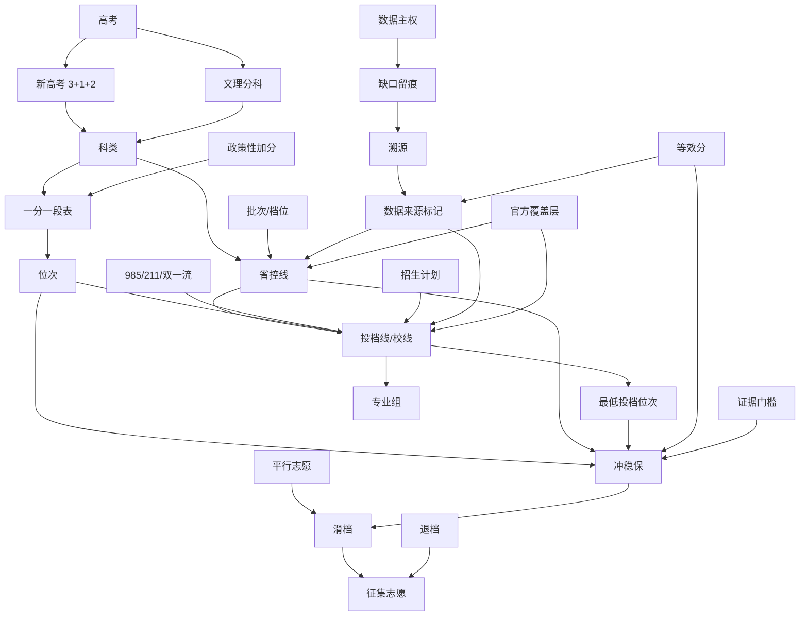

# 高考志愿填报领域专有名词图谱

> 范围：xuefeng 项目（高考志愿填报辅助系统）领域术语 ↔ 系统实现映射。
> 机器可读版本见同目录 [`domain-glossary.json`](./domain-glossary.json)（26 节点 / 30 关系边）。
> 版本：2026-10-21。

## 一、关系总览（Mermaid）

## 二、分类释义

### 考试制度
| 术语 | 别名 | 释义 |
|---|---|---|
| 高考 | 普通高等学校招生全国统一考试 | 高校招生选拔性考试，分数与位次是后续一切录取判断的基准。 |
| 新高考 3+1+2 | 3+1+2 模式 | 语数外+首选物理/历史+再选两科；2025 起宁夏、青海等省全面落地，科类归物理类/历史类。 |
| 文理分科 | 旧高考、大文大理 | 改革前的文科/理科分科；2022–2024 多数西部省份仍沿用，科类归文科/理科。 |

### 批次与科类
| 术语 | 别名 | 释义 / 系统落点 |
|---|---|---|
| 科类 | 科目类、选科 | 物理类/历史类(新高考) 或 文科/理科(文理分科)；合并批次省(沪京津浙琼鲁)称「综合」。`admission_baselines.subject` 对合并批次省用「综合」单科；一分一段表按物理类/历史类双写，由 `_official_ctrl_line` 别名回退。 |
| 批次/档位 | 批次线、录取批次 | 本科提前批、本科一批(普通一本)、本科二批(普通二本)、专科批。新全量省控线归一为 普通一本/普通二本/专科；合并批次省 baseline 用 本科批/一段/二段。`admission_baselines.tier` ∈ {985,211,普通一本,普通二本,专科}。 |

### 分数与位次
| 术语 | 别名 | 释义 / 系统落点 |
|---|---|---|
| 一分一段表 | 成绩分段统计表、位次表 | 逐分统计「该分数及以上累计人数」，位次唯一权威来源。`data/rank_tables/{year}/{province}.json`，由 `backend/rank_sync/` 每省独立模块采集；官方多为图片/PDF/扫描件，按纪律不 OCR、不臆造。 |
| 位次 | 排名、名次 | 考生成绩在全省同科类的排序位置；「用户稳够」= 最低投档位次 > 用户位次。口径：min_rank=录取末位考生位次，数字越大门槛越低；位次余量=line_rank−user_rank。 |
| 最低投档位次 | 投档位次、录取末位位次 | 校线对应最低录取位次，冲稳保与位次余量计算核心。`school_lines.min_rank`；官方行须带可点 source_url。 |
| 政策性加分 | 加分、照顾分 | 民族/烈士子女/退役军人等投档加分，计入总分。青海/宁夏等省控线注明「总分已含政策性加分」。 |

### 分数线
| 术语 | 别名 | 释义 / 系统落点 |
|---|---|---|
| 省控线 | 录取控制分数线、批次线 | 省级考试院划定的某科类某批次最低录取控制分数。`data/admission_control_lines_2022_2026.json`(31省,阳光高考转录) + `data/admission_official_2024.json`(6省985/211校线) → `admission_baselines`；data_source=official(31省省控线)+legacy(6省校线)+estimated(31省 gaokao-advisor)。 |
| 投档线/校线 | 院校投档分数线、最低投档分 | 某院校专业组实际投档的最低分/最低位次，必 ≥ 省控线。`school_lines` 表；种子 `school_lines_estimated_real.json.gz`(14020 行 estimated_real) + 官方 22 行 985/211 + 省考试院逐校原表；data_source=official/estimated_real/estimated。 |

### 志愿策略
| 术语 | 别名 | 释义 / 系统落点 |
|---|---|---|
| 冲稳保 | 冲稳保梯度 | 按位次余量分冲/稳/保三档避免滑档。`services/verify.py`，输入 user_rank + 校线/省控线 min_rank。 |
| 等效分 | 等位分、等效成绩 | 往年/异源分数按位次折算成今年可比分数。`services/equiv_score.py`，优先取 official 锚定。 |
| 平行志愿 | 平行投档 | 同批次多志愿「分数优先、遵循志愿」投档，降低落榜风险。 |
| 滑档 | 掉档 | 分数未达所填所有志愿投档线，本批次未投出；合理冲稳保梯度可避免。 |
| 退档 | 退滑 | 投档后因体检/单科/不服从调剂被退回。 |
| 征集志愿 | 补录、征求志愿 | 某批次未满公布缺额再征集；滑档/退档后可参与。 |

### 院校与专业
| 术语 | 别名 | 释义 / 系统落点 |
|---|---|---|
| 专业组 | 院校专业组 | 新高考投档单位，院校按选科要求打包专业，考生按组投档。`school_lines.group_code`；唯一键 (year,province,subject,university,group_code)。 |
| 985/211/双一流 | 院校层次 | 国家高校建设工程层次标签，影响投档线高低。`universities`(985=38 不含军校, 211=112, 全国 2868 所)；`admission_baselines.tier` 含 985/211 入门投档。 |
| 招生计划 | 招生名额、计划数 | 院校在某省某专业组招生人数，决定竞争激烈度。 |

### 数据治理（系统特有）
| 术语 | 别名 | 释义 / 系统落点 |
|---|---|---|
| 数据主权 | 数据自持 | 上游爬虫易下架，核心种子须归本仓库自持、可离线重建。`school_lines` 仓库内置 gzip 种子；`rank_tables` 每省独立可复用工具。 |
| 数据来源标记 | 来源口径 | 每行可信度标签：official(考试院官方)/estimated_real(真实抓取)/estimated(模型估算)。优先官方；缺 source_url 整份拒收；estimated_real 永不自动升 official。 |
| 官方覆盖层 | overlay | 在 estimated 基线上叠加 official 行：省控线 31 省(阳光高考)、985/211 校线 6 省(旧文件)。生效年份官方行 min_rank 保留 estimated 值，避免置 0 拉垮排名。`db/seed.py::sync_admission`。 |
| 证据门槛 | 证据强度 | 核验结论所需证据量：none(<3条/<2所)/thin/full(≥10条且≥5所)/refuted(≥20条/≥10所)。`services/verify._evidence_band`，可用 `scripts/calibrate_evidence_gate.py` 校准。 |
| 溯源 | source_url、可追溯 | 每条官方数据须带可点来源链接，落盘记 sha256 与文件名；缺来源整份拒收。`meta.source_url` / `source_sha256_map` / `attachment_sha256_map`。 |
| 缺口留痕 | KNOWN_GAPS、blocked | 官方仅图片/扫描件或站点改版等无法机读时，按纪律标 pending/blocked/KNOWN_GAPS 并写明原因，不 OCR、不臆造。`backend/rank_sync/provinces/*.py` 的 KNOWN_GAPS 与 `__init__.py` 的 BLOCKED。 |

## 三、使用建议
- **新人 onboarding**：先读关系图，再按分类释义对照系统中的 `admission_baselines` / `school_lines` / `rank_tables` 三张核心数据。
- **数据质量排查**：沿 `数据来源标记 → 官方覆盖层 → 溯源 → 缺口留痕` 链路，可定位任意一行数据的可信度与来源。
- **跨年/跨省比较**：必经 `等效分`（位次折算），严禁直接比裸分。
- **排名口径**：一切以「位次」而非「分数」为准；校线用 `min_rank`，省控线缺位次时 fallback 到 estimated 基线位次。
